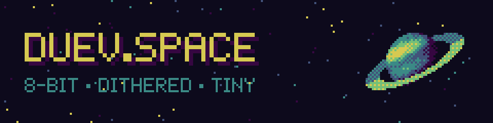

<p align="center"><a href="https://duev.space"></a></p>

<p align="center"><code>~60 KB · no build · no deps · no trackers</code></p>

```sh
python3 -m http.server -d public                # play locally
uv run --with pillow tools/make_assets.py         # re-dither the art
```

Served from `public/` by Cloudflare Pages. ↑↑↓↓←→←→BA
